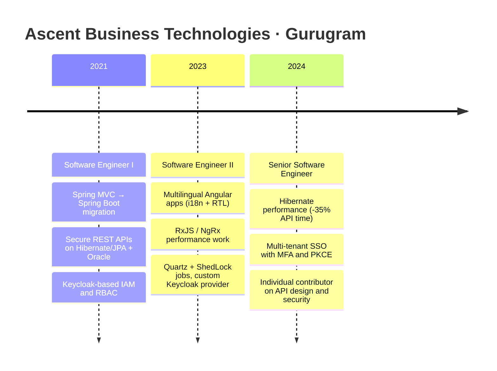

<p align="center">
  
</p>

<p align="center">
  <a href="https://github.com/Its-Nitin">
    
  </a>
</p>

<p align="center">
  <a href="https://www.linkedin.com/in/nitin-kumar-k7"></a>
  <a href="mailto:nitinkumarblb@gmail.com"></a>
  
  
</p>

<p align="center">
  
  
  
  
</p>

---

## 👨‍💻 About me

```java
public record Engineer(
        String name,
        String role,
        int yearsOfExperience,
        List<String> coreStack,
        List<String> specializations,
        List<String> currentFocus
) {
    public static Engineer nitin() {
        return new Engineer(
            "Nitin Kumar",
            "Senior Software Engineer",
            5,
            List.of("Java", "Spring Boot", "Microservices", "Angular", "TypeScript", "PostgreSQL/Oracle"),
            List.of(
                "Microservices architecture & REST API design",
                "Identity & access management (Keycloak, OAuth2, OIDC)",
                "Legacy-to-modern platform migration",
                "Multi-tenant, multilingual enterprise applications"
            ),
            List.of("Containerization (Docker, Kubernetes)", "System design", "AI-assisted engineering")
        );
    }
}
```

I'm a **Java Full Stack Engineer with 5+ years of experience** building enterprise platforms end to end. On the backend I design and build **Spring Boot microservices and APIs** with strong security and data-access foundations. On the frontend I build **Angular applications** that stay responsive and consistent across languages and devices. I'm most useful on systems that need to be **secure, scalable and maintainable** as they grow.

---

## 🚀 Impact at a glance

<table align="center">
  <tr>
    <td align="center" width="25%"><h2>35%</h2><b>faster API responses</b><br/><sub>Hibernate N+1 fixes, native SQL and execution-plan tuning</sub></td>
    <td align="center" width="25%"><h2>Multi-tenant</h2><b>SSO platform</b><br/><sub>Keycloak with MFA, PKCE and RBAC across applications</sub></td>
    <td align="center" width="25%"><h2>XML → Boot</h2><b>legacy modernization</b><br/><sub>Spring MVC/Servlet moved to annotation-driven Spring Boot</sub></td>
    <td align="center" width="25%"><h2>EN + AR</h2><b>global-ready UIs</b><br/><sub>Angular i18n with full RTL support, web and mobile</sub></td>
  </tr>
  <tr>
    <td align="center"><h2>+30%</h2><b>UI responsiveness</b><br/><sub>RxJS / NgRx state management</sub></td>
    <td align="center"><h2>+25%</h2><b>fresher dashboards</b><br/><sub>Quartz + ShedLock background jobs</sub></td>
    <td align="center"><h2>+20%</h2><b>auth flexibility</b><br/><sub>custom Keycloak provider for user/group queries</sub></td>
    <td align="center"><h2>Audit-ready</h2><b>data history</b><br/><sub>Hibernate Envers for traceable changes</sub></td>
  </tr>
</table>

---

## 🧭 Career journey



---

## 🔬 Case studies

<details>
<summary><b>⚡ Cutting API response time by 35%</b></summary>

- **Problem:** Slow endpoints in a data-heavy enterprise platform.
- **Diagnosis:** Hibernate N+1 query patterns and queries that didn't use the best execution path.
- **Fix:** Fetch strategy changes, native SQL and `EntityManager` for hot paths, tuning based on execution plans.
- **Result:** **~35% lower API response time**, plus Hibernate Envers for audit without sacrificing throughput.

</details>

<details>
<summary><b>🔐 Multi-tenant SSO with Keycloak</b></summary>

- **Problem:** Several applications needed one secure, consistent way to sign users in.
- **Fix:** Centralized identity on Keycloak with MFA, PKCE and role-based access control, plus a custom provider for advanced user and group queries.
- **Result:** **Multi-tenant SSO**, simpler access management, and more flexible authentication (**~20%**).

</details>

<details>
<summary><b>🏗️ Legacy to Spring Boot</b></summary>

- **Problem:** A Spring MVC / Servlet system held together with XML configuration.
- **Fix:** Built an upgraded Spring Boot platform alongside the legacy one and replaced XML wiring with annotation-driven components.
- **Result:** Simpler dependency management, easier maintenance, and a clear modernization path.

</details>

<details>
<summary><b>🌍 Arabic + English Angular apps</b></summary>

- **Problem:** One product, two languages, two reading directions.
- **Fix:** Angular i18n with full RTL layout support, and RxJS / NgRx state management for speed.
- **Result:** Consistent UX on web and mobile, and **~30% better responsiveness**.

</details>

---

## 🛠️ Tech stack

<p align="center">
  
</p>

| Area | What I use |
|---|---|
| **Backend** | Java, Spring Boot, Spring Security, REST APIs, Microservices, JPA/Hibernate, Envers, Jakarta migration |
| **Frontend** | Angular (v10–v20), TypeScript, RxJS, NgRx, Reactive Forms, i18n/RTL, Next.js |
| **Security** | Keycloak, OAuth2, PKCE, MFA, JWT, RBAC |
| **Data** | Oracle, MSSQL, MySQL, PostgreSQL, native SQL optimization |
| **Jobs and real time** | Quartz, ShedLock, WebSockets (STOMP) |
| **AI-assisted dev** | Cursor, GitHub Copilot, Augment, Antigravity: faster coding, debugging, tests and docs, with the same quality bar |

---

## 📌 Featured projects

<table>
  <tr>
    <td width="50%" valign="top">
      <h3><a href="https://github.com/Its-Nitin/talkie-time">💬 TalkieTime</a></h3>
      <b>Real-time chat platform</b><br/>
      One-to-one messaging, chat history and live user presence. REST for data, WebSockets (STOMP) for real time, JWT for security.<br/><br/>
      
      
      
      
    </td>
    <td width="50%" valign="top">
      <h3><a href="https://github.com/Its-Nitin/church">⛪ Church Website</a></h3>
      <b>Client-style web UI</b><br/>
      A clean, responsive website built for a church, from design to delivery.<br/><br/><br/>
      
      
    </td>
  </tr>
</table>

---

## 🧱 How I build

- 📏 **Measure first.** I profile before I optimize, and I keep before-and-after numbers.
- 🔒 **Secure by default.** Authentication, roles and tenancy are designed in, not bolted on.
- 🧩 **Small, reviewable changes.** Easy to read, easy to test, easy to roll back.
- 🤖 **AI as a force multiplier.** I use it for speed, and I own the quality.

---

## 🌱 Currently levelling up

<p align="center">
  
  
  
  
</p>

---

## 📊 GitHub snapshot

<p align="center">
  
  
</p>

<p align="center">
  
</p>

---

## 🤝 Let's work together

I'm open to **full-time roles** (Java / Spring / Angular) and **freelance projects** (backend, security, or full-stack).

<p align="center">
  <a href="https://www.linkedin.com/in/nitin-kumar-k7"></a>
  <a href="mailto:nitinkumarblb@gmail.com"></a>
</p>

<p align="center"><i>"I like making slow systems fast and secure systems usable."</i></p>


